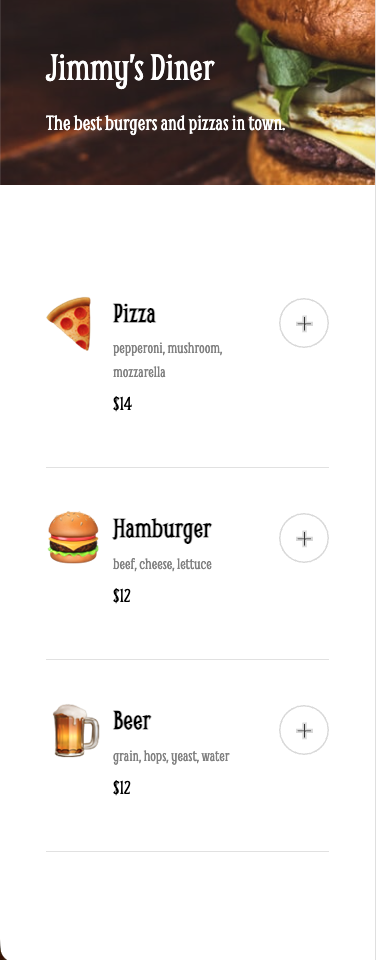
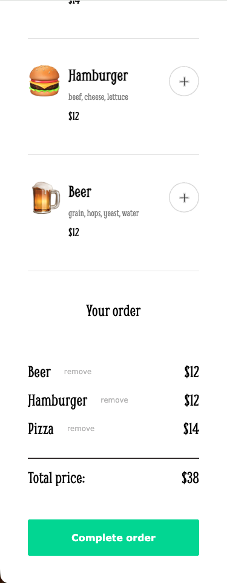

# Jimmy's Diner — Restaurant Ordering App

A mobile-first restaurant ordering app built with vanilla JavaScript.
Users can browse the menu, add and remove items, see the total price,
and complete the order through a payment form with validation.

**[Live demo](https://jimmys-diner-yurdoy.netlify.app)**

<p>
  
  
</p>

## Features

- Menu rendered dynamically from a data file
- Add items to the order and remove them individually
- Total price calculated automatically
- Order section appears and hides depending on its contents
- Payment modal with required fields and format validation
- Personalized confirmation message after payment
- Keyboard accessible: visible focus styles, labelled buttons,
  screen-reader announcements
- Lighthouse: Accessibility 100, Best Practices 100, SEO 100
- Meal deal: pizza + beer in one order gives 15% off the pair

## Built with

- HTML5 (semantic markup)
- CSS3: Flexbox, BEM, custom properties, media queries
- JavaScript (ES6 modules)
- Vite
- Netlify (deploy)

## What I learned

- Used event delegation with `closest()` and data attributes to handle clicks on dynamically rendered buttons with a single listener.
- Learned that `dataset` values are always strings, since HTML attributes are plain text, and converted them with `Number()` before comparing with numeric IDs.
- Practiced array methods in a real context: `map()` to render HTML, `find()` to look up menu items by ID, `splice()` to remove a single order item by index, and `reduce()` to calculate the total.
- Kept the order array as the single source of truth: every action updates the data first, then re-renders the order list, total, and visibility from it.
- Used `classList.toggle()` with a condition to show or hide the order section based on the data, and learned when it doesn’t fit: the confirmation message depends on an event (payment), not on the data, so it needs explicit `add/remove`.
- Handled the payment form with the `submit` event instead of a button click, so built-in validation (`required`, `pattern`) runs first; used `preventDefault()` to stop the page reload and `FormData` to read the customer’s name.
- Made the app keyboard and screen-reader friendly: descriptive `aria-labels` on icon buttons, visible `:focus-visible` styles, visually hidden form labels, a `role="status"` confirmation message, and moving focus into the payment modal when it opens.
- Moved the meal deal rules (item IDs and discount percent) into the data file, so the promo can change without touching the logic; used `some()` to check the order and an early `return` to keep the function flat.
- Formatted all prices through a single `formatPrice()` helper with `toFixed(2)`.

## Running locally

```bash
git clone https://github.com/Yurdoy/restaurant-ordering-app.git
cd restaurant-ordering-app
npm install
npm run dev
```

## Credits

Design and project brief by [Scrimba](https://scrimba.com)
as part of the Full Stack Developer Course.
